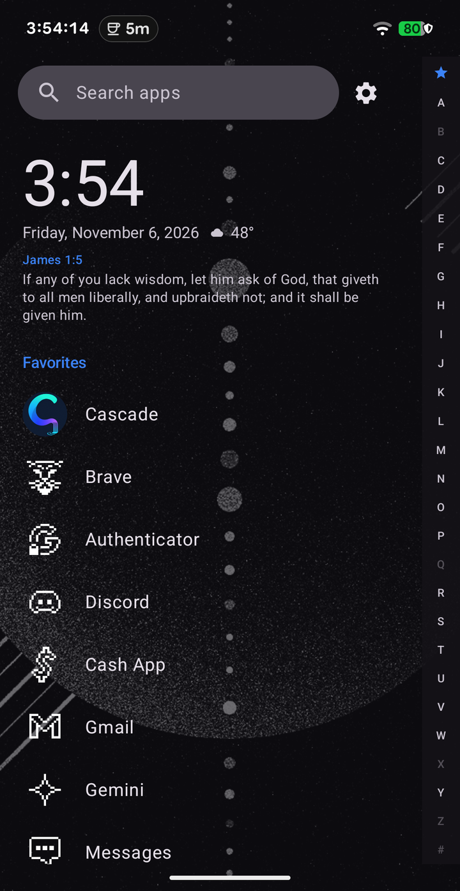
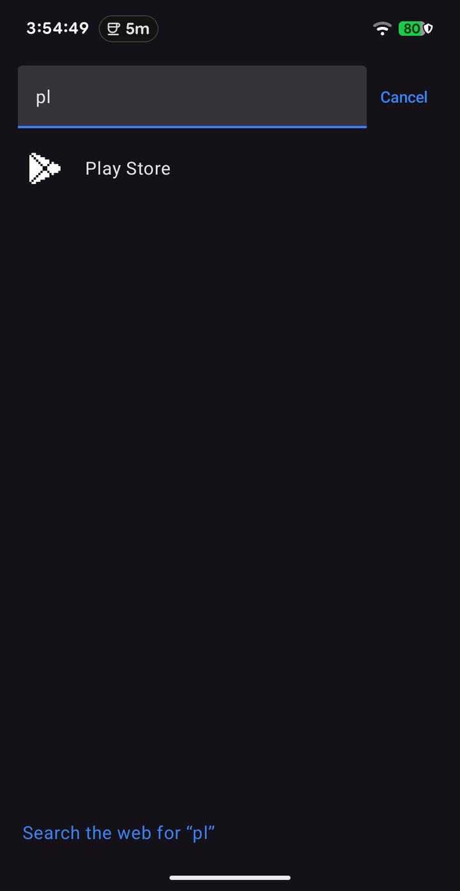
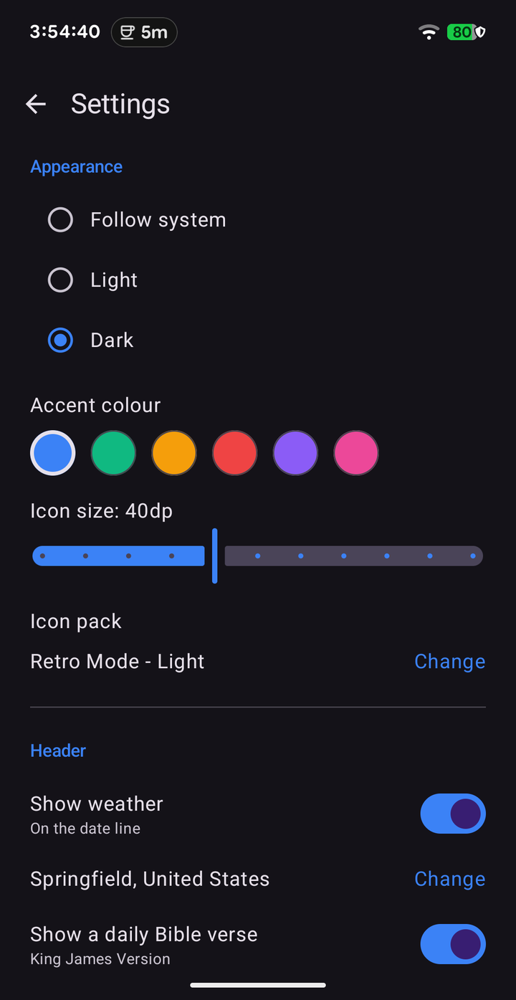

<div align="center">

# Cascade

**A calm, fast Android launcher.**
Vertical apps, pop-up folders, icon packs, notification dots, weather and a quiet header — no ads, no accounts, no analytics.

[](https://github.com/jesussaves-ai/cascade-launcher/releases)
[](LICENSE)
[](https://developer.android.com)
[](https://kotlinlang.org)

</div>

<p align="center">
  
  
  
</p>

Cascade is an independent, open-source launcher. It is inspired by the
*workflow* of Niagara Launcher — a one-handed vertical list with a wave
alphabet — and contains no code, assets, strings or resources from any
third-party launcher.

## Why it exists

Most launchers want an account, a feed, or your attention. Cascade wants a
single column of apps, a clock, and to get out of the way.

- **No ads, no tracking, no account.** Nothing leaves the device except an
  optional weather lookup.
- **One column, one thumb.** Apps, favourites and folders in a single
  scrolling list with a letter rail on the right.
- **Small on purpose.** About 5k lines of Kotlin and Compose, no bundled SDKs.

## Features

- Vertical A–Z list with sticky letter headers and a `#` bucket
- Favourites: long-press to pin, drag to reorder, no limit
- Wave alphabet rail with a star that jumps to favourites; empty letters dimmed
- Pop-up folders: create from a long-press, 2×2 preview, 4-column popup
- Search: apps, optional contacts, and a “search the web” row
- Notification dots and a live notification list in the long-press sheet
- ADW icon packs, per-app icon overrides, and a letter tile when an icon is missing
- Large clock, optional weather and a daily KJV verse
- System widgets under the clock
- Wallpaper behind a readable scrim; long-press the clock to change it
- Double-tap the clock to lock (optional device admin)
- Light, dark or system theme, six accents, adjustable icon size
- Hidden apps, app info, uninstall from the long-press sheet

## Install

1. Download the latest `cascade-<version>.apk` from
   [Releases](https://github.com/jesussaves-ai/cascade-launcher/releases).
2. Open it on the phone and allow install from an unknown source when prompted.
3. Press Home and choose **Cascade**, then **Always**.

Requires Android 8.0 (API 26) or newer. Tested on Android 17.

## Build

```bash
export JAVA_HOME=/usr/lib/jvm/java-17-openjdk
export ANDROID_HOME=$HOME/Android/Sdk
./gradlew assembleDebug        # debug APK
./gradlew assembleRelease      # signed release, needs keystore.properties
./gradlew testDebugUnitTest    # JVM tests
```

`keystore.properties` (git-ignored) needs `storeFile`, `storePassword`,
`keyAlias` and `keyPassword`.

## Privacy

| Data | Where it goes |
| --- | --- |
| Apps, favourites, folders, settings | Local preferences only |
| Notifications | Memory only, never written to disk |
| Contacts (optional) | Memory only, cleared when turned off |
| Weather (optional) | Sent to Open-Meteo as a city name |
| Analytics / ads / accounts | None |

Cascade declares `INTERNET` for the optional weather lookup, nothing else it
does touches the network.

## Project layout

```
app/src/main/java/dev/tom/cascade/
├── admin/          device-admin receiver for double-tap lock
├── data/           apps, contacts, weather and preference stores
├── iconpack/       icon pack discovery, mapping and overrides
├── model/          app, folder, contact, weather and verse models
├── notifications/  notification listener, store and flags
├── ui/             Compose screens, dialogs and gestures
└── util/           pure sorting, search, clock and formatting helpers
```

Logic that can be tested without Android lives in `util/`, `data/` codecs and
`iconpack/` parsers, with JVM tests beside them.

## Licence

MIT — see [LICENSE](LICENSE).
