<div align="center">


# Cascade

**A calm, fast Android launcher.**<br>
One column of apps, a clock, and nothing that wants your attention.

[](https://github.com/jesussaves-dev/cascade-launcher/releases/latest)
[](https://developer.android.com)
[](https://kotlinlang.org)
[](LICENSE)

[**Download the APK**](https://github.com/jesussaves-dev/cascade-launcher/releases/latest) · [Themes](#twelve-themes) · [Foldables](#foldables) · [Features](#features) · [Privacy](#privacy) · [Build](#build)

</div>

<br>

> No ads. No account. No analytics. The only network request it can make is an optional weather lookup.

## Twelve themes

Each theme changes the type, colours, clock, search field, section headers and alphabet rail. You choose one in **Settings → Appearance → Theme**.

<table>
  <tr>
    <td align="center">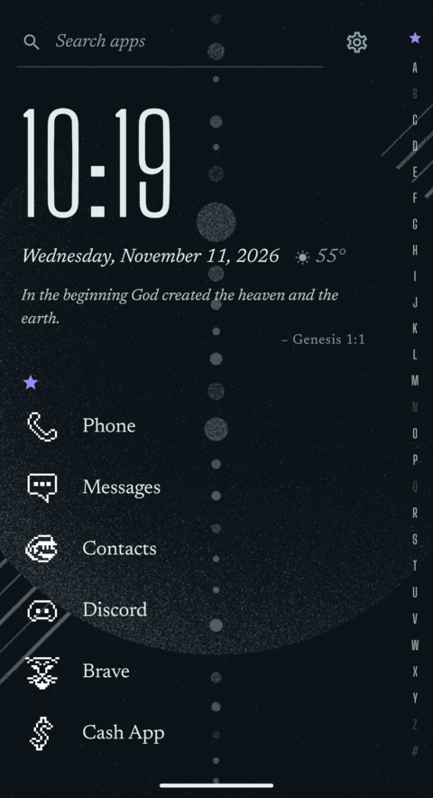<br><b>Index</b><br><sub>A book's index. Tall condensed clock, serif names, large initials.</sub></td>
    <td align="center">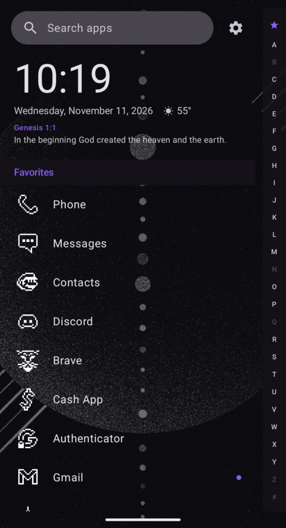<br><b>Original</b><br><sub>Cascade 1.0. Roboto, a search pill, the rail on a strip.</sub></td>
    <td align="center">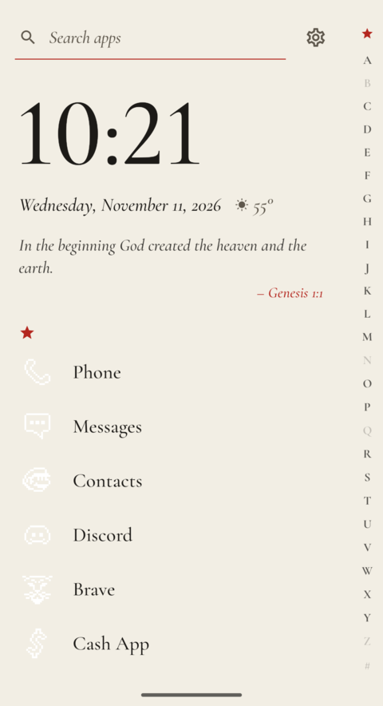<br><b>Rubric</b><br><sub>A prayer book. Garamond, with initials printed in red.</sub></td>
    <td align="center">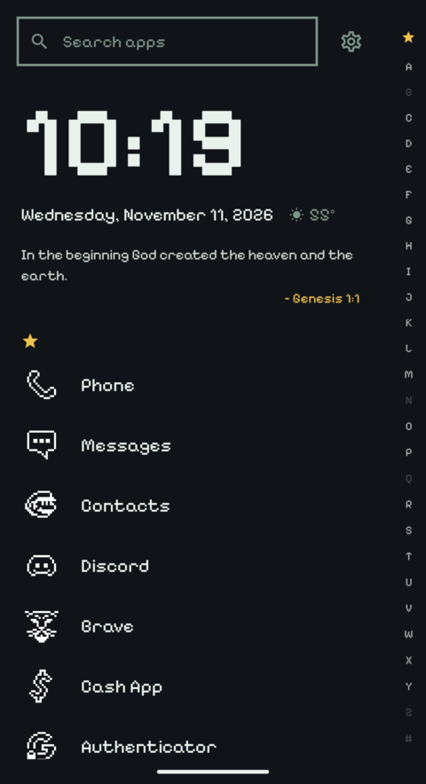<br><b>Pixel</b><br><sub>Pixel type, amber on green-black, boxed search.</sub></td>
  </tr>
  <tr>
    <td align="center">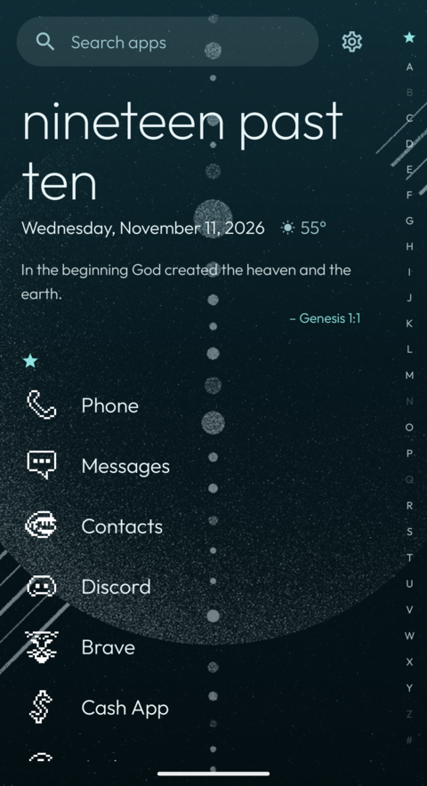<br><b>Tide</b><br><sub>The time in words, over deep water.</sub></td>
    <td align="center">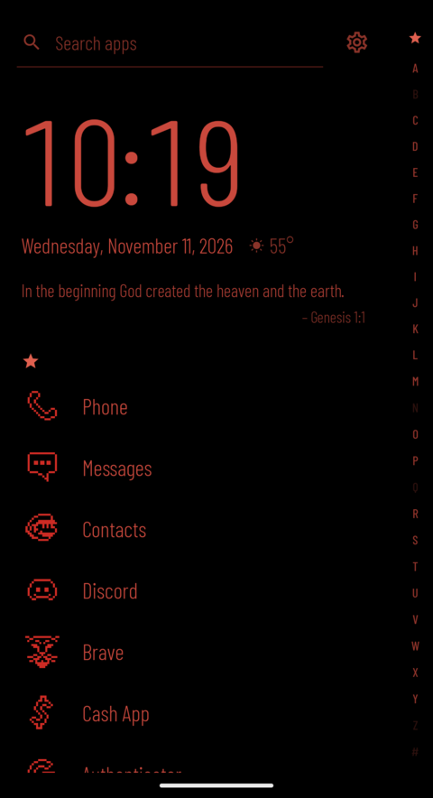<br><b>Night watch</b><br><sub>OLED black and dim red, icons included. Dark only.</sub></td>
    <td align="center">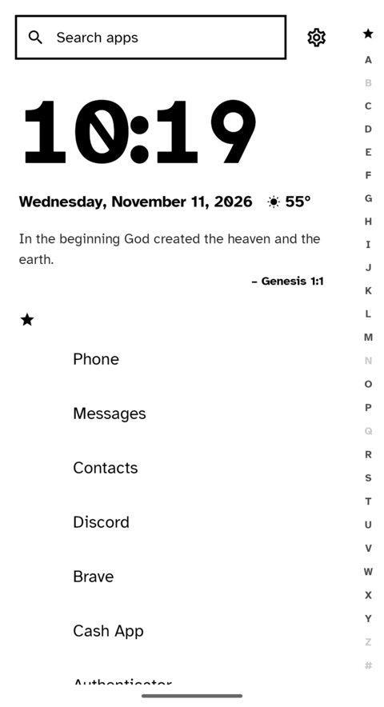<br><b>Paper</b><br><sub>Black on white for e-ink and bright sun. Light only.</sub></td>
    <td align="center">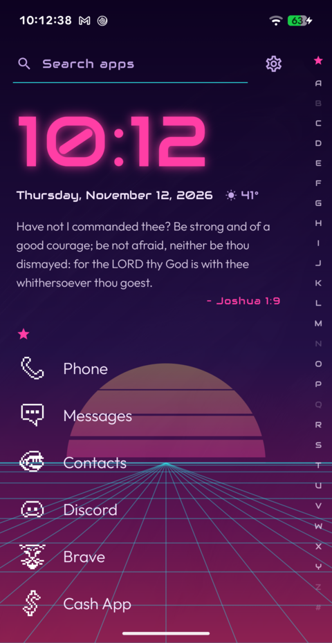<br><b>Outrun</b><br><sub>A neon clock over a sunset and a horizon grid. Dark only.</sub></td>
  </tr>
  <tr>
    <td align="center">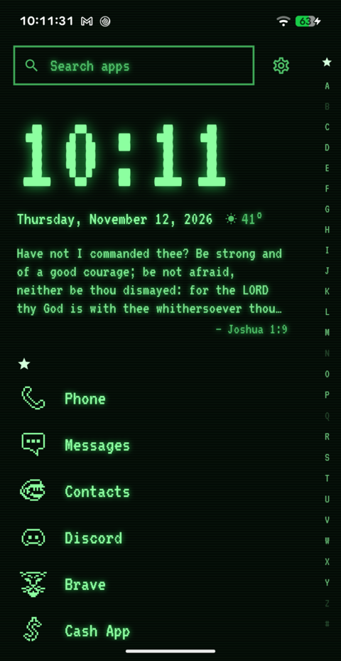<br><b>Phosphor</b><br><sub>A green CRT. Glowing type, scanlines, green icons. Dark only.</sub></td>
    <td align="center">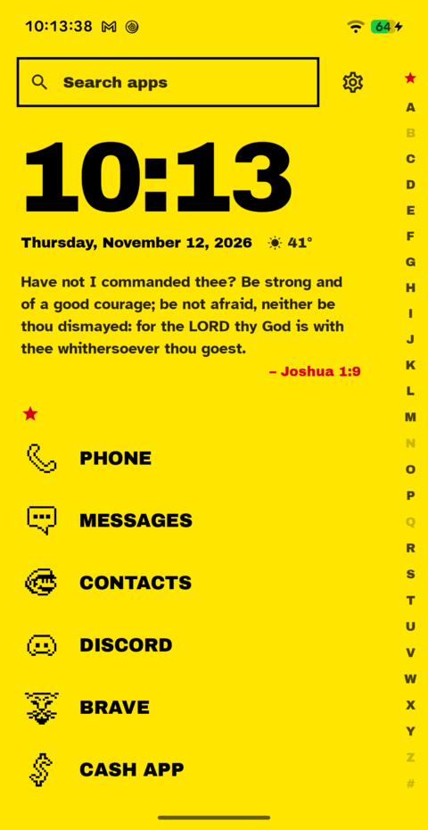<br><b>Poster</b><br><sub>Brutalist capitals on safety yellow, or yellow on black.</sub></td>
    <td align="center">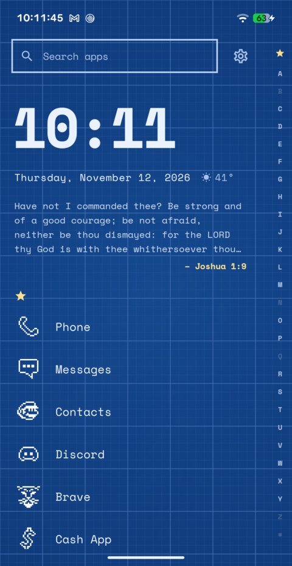<br><b>Blueprint</b><br><sub>Monospace on a drafting grid. Cyanotype or white sheet.</sub></td>
    <td align="center">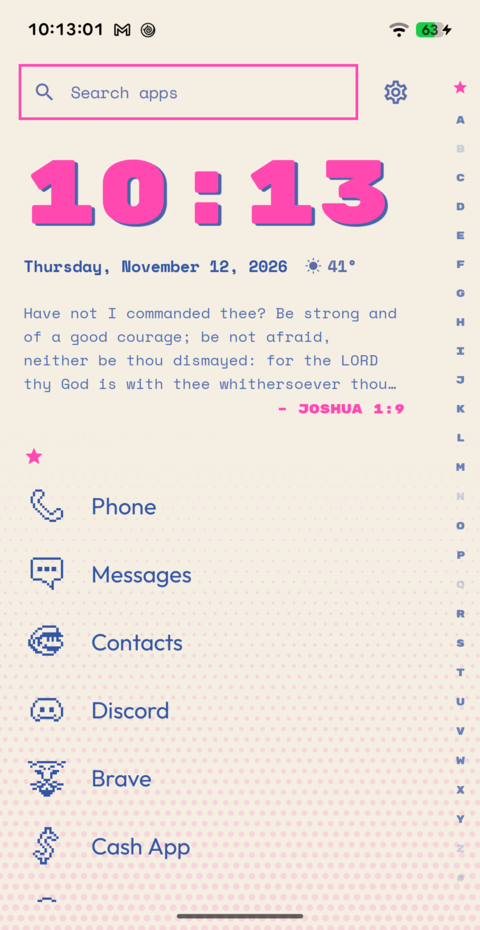<br><b>Riso</b><br><sub>Two-ink print: pink slipped out of register over blue. Light only.</sub></td>
  </tr>
</table>

Original and Index let you pick one of six accent colours. The other themes set their own. Outrun, Phosphor and Night watch are dark only; Paper and Riso are light only. The rest have both.

**At night** switches to a second theme of your choice from sunset to sunrise in your weather city, or from 9 pm to 7 am without one. The sun's position is worked out on the phone.

## Foldables

Unfold the phone and Cascade opens like a book: the clock, verse and widgets on the left page, your apps on the right. Any screen at least 600dp wide gets the two pages, including a phone turned on its side.

<div align="center">
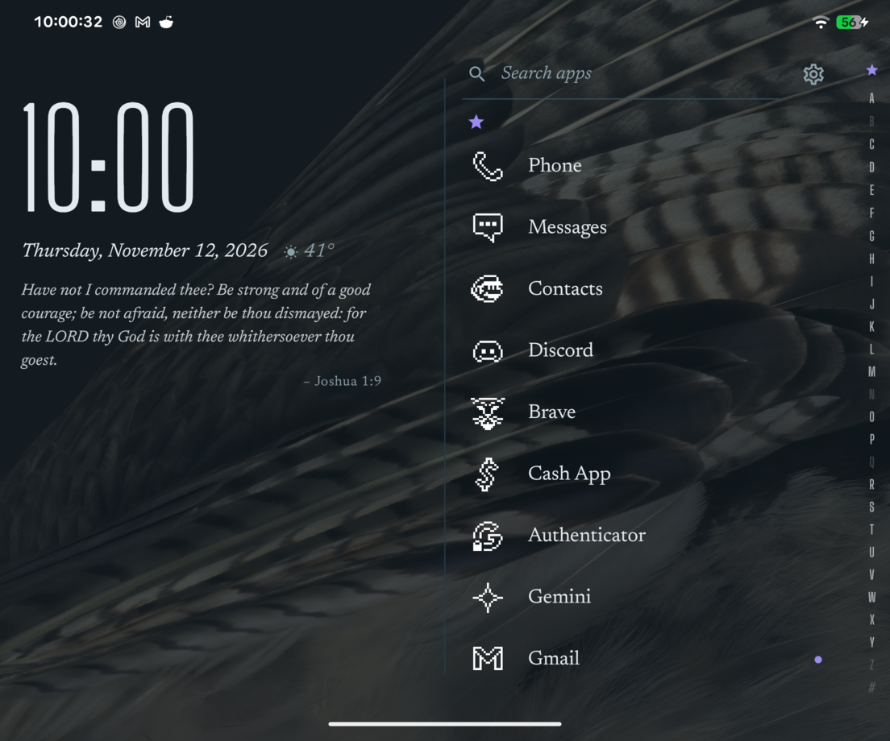
</div>

## Features

|  |  |
| --- | --- |
| **List** | A–Z apps with sticky letter headers, a `#` bucket and a wave alphabet rail. Letters with no apps are dimmed. |
| **Favourites** | Long-press an app to pin it, drag to reorder, no limit. The star on the rail jumps back to them. |
| **Folders** | Pop-up folders with a 2×2 preview, created from the long-press sheet. |
| **Search** | Apps, optional contacts, and a "search the web" row. Matches initials ("gm" finds Google Maps) and forgives a typo, and puts the apps you use most first. |
| **Notifications** | Dots on apps and a live notification list in the long-press sheet. |
| **Icons** | ADW icon packs, per-app icon overrides, and a letter tile when an icon is missing. Icon size is adjustable. On Android 13+, themed icons redraw apps' monochrome icons in the theme's colours. |
| **Header** | A large clock, optional weather and a daily KJV verse. System widgets sit under it. |
| **Gestures** | Double-tap the clock to lock the screen (optional device admin). Long-press it to change the wallpaper. Swipe down for notifications and up for search, on the clock or past either end of the list; both are configurable. |
| **Housekeeping** | Hide apps, open app info and uninstall from the long-press sheet. |

## Install

1. Download `cascade-<version>.apk` from the [latest release](https://github.com/jesussaves-dev/cascade-launcher/releases/latest).
2. Open it on the phone and allow installs from that source when Android asks.
3. Press Home, then choose **Cascade** and **Always**.

Needs Android 8.0 (API 26) or newer. Tested on Android 17 (Pixel Fold).

## Privacy

| Data | Where it goes |
| --- | --- |
| Apps, favourites, folders, settings | Local preferences only |
| Notifications | Memory only, never written to disk |
| Contacts (optional) | Memory only, cleared when turned off |
| Weather (optional) | The city name is sent to Open-Meteo |
| Analytics, ads, accounts | None |

Cascade declares `INTERNET` only for the weather lookup.

## Build

```bash
export JAVA_HOME=/usr/lib/jvm/java-17-openjdk
export ANDROID_HOME=$HOME/Android/Sdk
./gradlew assembleDebug        # debug APK
./gradlew assembleRelease      # signed release, needs keystore.properties
./gradlew testDebugUnitTest    # JVM tests
```

`keystore.properties` is git-ignored. It needs `storeFile`, `storePassword`, `keyAlias` and `keyPassword`.

<details>
<summary><b>Project layout</b></summary>

```
app/src/main/java/dev/tom/cascade/
├── admin/          device-admin receiver for double-tap lock
├── data/           apps, contacts, weather and preference stores
├── iconpack/       icon pack discovery, mapping and overrides
├── model/          app, folder, contact, weather and verse models
├── notifications/  notification listener, store and flags
├── ui/             Compose screens, dialogs and gestures
│   └── theme/      the twelve themes: palettes, fonts, ground patterns and HomeStyle
└── util/           pure sorting, search, clock and formatting helpers
```

Code that runs without Android lives in `util/`, the `data/` codecs and the `iconpack/` parsers. Their JVM tests mirror that layout under `app/src/test/`.

</details>

## Credits

Cascade takes its workflow from Niagara Launcher: a one-handed vertical list with a wave alphabet. It contains no code, assets, strings or resources from any other launcher.

The bundled fonts are Big Shoulders Display, Newsreader, Cormorant Garamond, Pixelify Sans, Outfit, Barlow Condensed and Atkinson Hyperlegible. All are under the SIL Open Font License, and the licence texts are in [`app/src/main/assets/licenses`](app/src/main/assets/licenses).

## Support

Cascade is free, with no ads and no paywalls. If you'd like to say thanks:

<a href="https://ko-fi.com/jesussavesai"></a>

## Licence

MIT. See [LICENSE](LICENSE).
